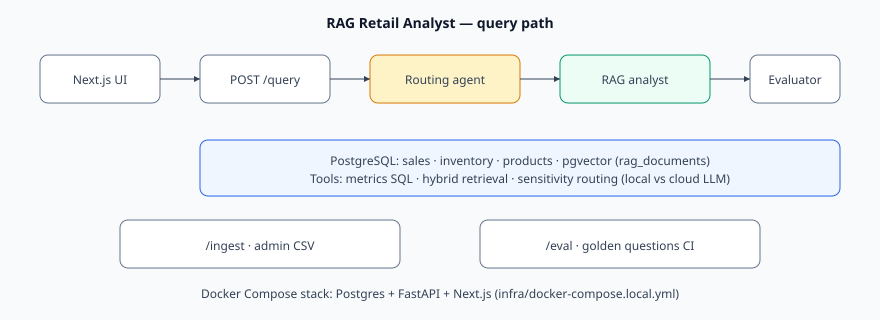

# RAG Retail Analyst

## Business case

Small and mid-size retailers need answers like “why did margin drop?” or “what will stock out next week?”, but generic chatbots **hallucinate without inventory truth**, and SaaS analytics often require **sending sales data to vendor clouds** the business does not control.

This product is built for **evidence-linked retail intelligence**: metrics from `sales`, `inventory`, and `products` tables, retrieval over ingested documents, and agent orchestration that can **abstain when data is missing** (see `memory-bank/core/product-spec.md`). Sensitivity routing prepares the design for **local vs cloud LLM** without mixing confidential rows into the wrong model call. **Intent:** a **vertical reference implementation** for sovereign RAG in operations—partner-ready demos via Docker Compose, not a multi-tenant SaaS in this repo.

**Stack:** FastAPI · Pydantic AI agents · PostgreSQL · pgvector · Next.js  
**License:** [MIT](LICENSE)  
**Topics:** `rag` · `retail` · `fastapi` · `nextjs` · `postgresql` · `pydantic-ai`

**Status:** Phase 4 complete (analyst UI, filters, admin CSV ingestion). Phase 5 targets evaluator hardening and hybrid cloud routing.

---

## Overview

This project shows how to ship a **domain-specific analyst** without surrendering data to a black-box SaaS: schemas and goldens live in-repo (`memory-bank/`), retrieval and SQL tools are explicit, and Docker Compose provides a one-command local stack for partner demos.

---

## Query workflow

<p align="center">
  
</p>

---

## Quick start

```bash
git clone https://github.com/hfuenzalida/rag-retail-analyst.git
cd rag-retail-analyst
cp infra/env.example infra/.env.local
docker compose -f infra/docker-compose.local.yml up --build
```

| Service | URL |
|---------|-----|
| API | http://localhost:8000 (`/docs`, `/healthz`) |
| UI | http://localhost:3000 |

### Local development (without Docker)

```bash
cd backend && pip install -r requirements.txt && pytest app/tests -v
cd frontend && npm install && npm run dev
```

Seed demo data (Postgres required):

```bash
cd backend && python -m app.db.seed
```

---

## Architecture layers

| Layer | Responsibility |
|-------|----------------|
| Data | `sales`, `inventory`, `products`, `rag_documents` (pgvector) |
| RAG | Ingestion, embeddings, hybrid retrieval |
| Agents | Pydantic AI orchestration (routing + analyst + evaluator) |
| Routing | Sensitivity check, local vs cloud LLM |
| API | `/query`, `/ingest`, `/eval`, `/healthz` |
| UI | Next.js Q&A and admin flows |

Authoritative specs for contributors and coding agents:

- `memory-bank/core/product-spec.md`
- `memory-bank/core/architecture.md`
- `memory-bank/core/agent-surface.md`
- `memory-bank/core/implementation-plan.md`

See also `CLAUDE.md` for guardrails.

---

## Repository layout

```
backend/app/      api, agents, tools, db, models
frontend/src/     UI components and API client
infra/            Docker Compose, env templates
memory-bank/      Specs, golden questions, plans
docs/workflows/   SVG diagrams
```

---

## Testing

```bash
cd backend && pytest app/tests -v
cd frontend && npm test && npm run build
# Optional DB integration:
# RUN_DB_INTEGRATION=1 pytest app/tests/test_integration_db.py -v
```

---

## Security configuration

- Copy `infra/env.example` to `infra/.env.local`; never commit secrets.
- Treat admin CSV ingestion as a **trusted-operator** action in production.

---

## Related portfolio repositories

| Repository | Focus |
|------------|--------|
| [fhir-interop-hub](https://github.com/hfuenzalida/fhir-interop-hub) | Healthcare · FHIR |
| [security-suite-orchestrator](https://github.com/hfuenzalida/security-suite-orchestrator) | DevSecOps |
| [digital-brain](https://github.com/hfuenzalida/digital-brain) | Founder OS |
| [ig-video-to-text](https://github.com/hfuenzalida/ig-video-to-text) | Media ML |
| [ai-3-layer-coder](https://github.com/hfuenzalida/ai-3-layer-coder) | AI routing |